  

  
  
  
  

<!-- Contribution snake: refreshed daily by .github/workflows/snake.yml (private contributions are on in profile settings). -->
<picture>
  <source media="(prefers-color-scheme: dark)" srcset="https://raw.githubusercontent.com/aceadones/aceadones/output/snake-dark.svg" />
  
</picture>

### ✦ About

I'm a designer who turned into an AI engineer. I direct a crew of Claude Code agents and ship in hours what used to take weeks: websites, software, tools.

⚚ &nbsp;building premium, cinematic websites at **3BY2WEB** 
⚚ &nbsp;making small, sharp tools under **Next Layer Labs** 
⚚ &nbsp;home turf: motion, scroll, WebGL, 3D in Blender 
⚚ &nbsp;off-screen: violin for 15 years, piano, and most instruments when nobody's listening

<!-- NOW: one line on what you're building this week. Update it every Monday. -->

### ✦ Shipped

<!-- Add one card per tool you ship. Ask Claude to generate the SVG card. -->

### ✦ Toolbox

  
  
  

XO ❦

